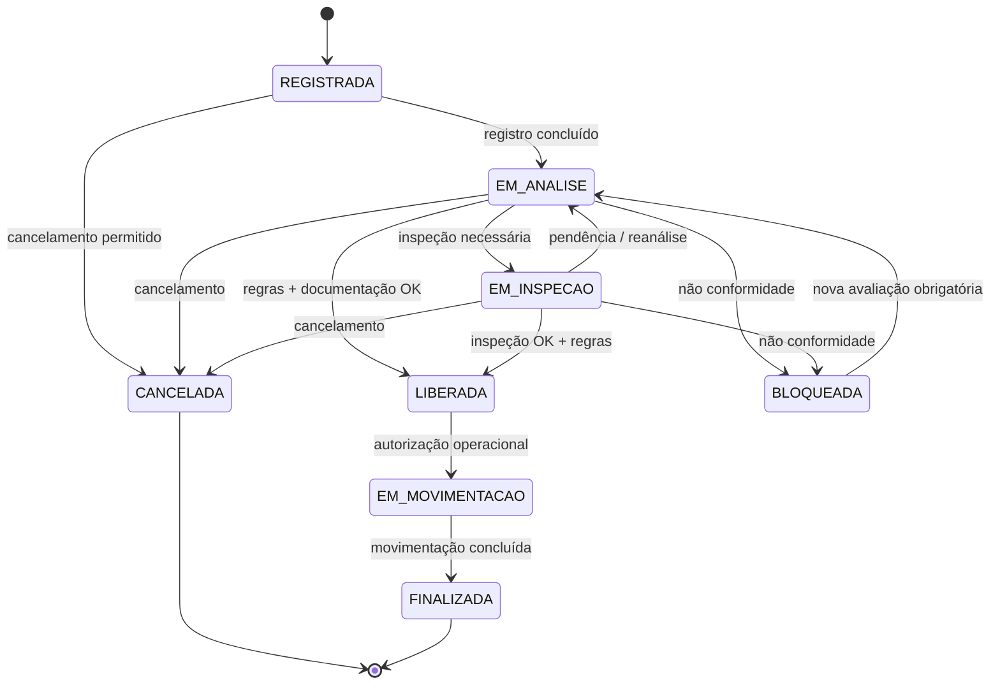

# Fluxo de Status

> Diagrama obrigatório da Fase 1: representa as transições permitidas e a decisão do grupo de retornar cargas bloqueadas para análise.

**Decisão do projeto:** `BLOQUEADA` não vai diretamente para `LIBERADA`; retorna para `EM_ANALISE` antes de uma nova avaliação.
