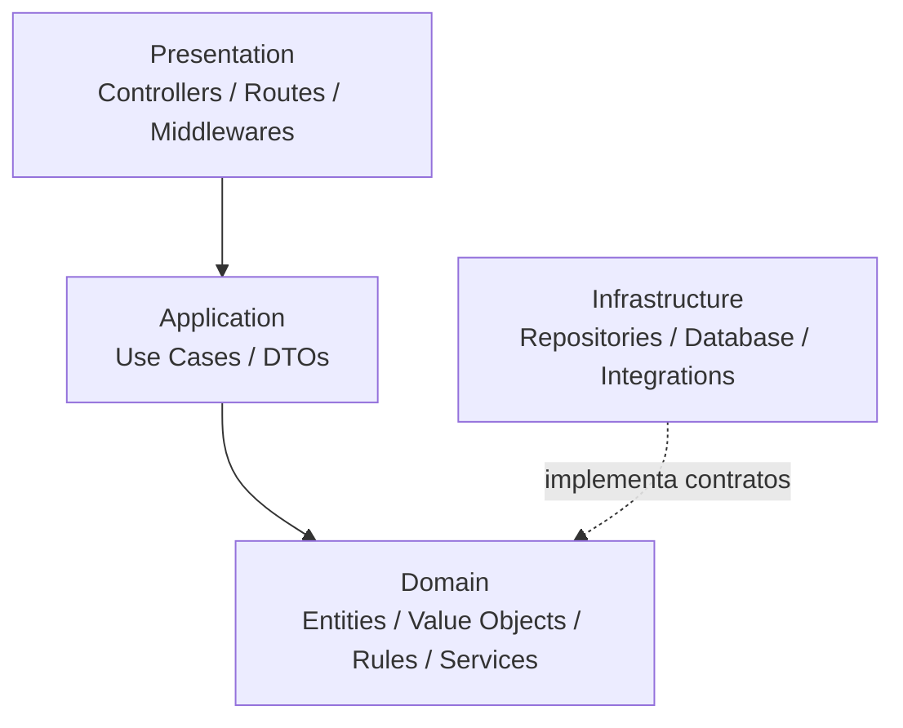

# Diagrama de Arquitetura

> Diagrama complementar: mostra separação de responsabilidades e o sentido das dependências.

**Decisão:** o domínio não depende diretamente de framework, banco ou ORM. A infraestrutura implementa os contratos necessários sem inverter a direção do núcleo de negócio.
